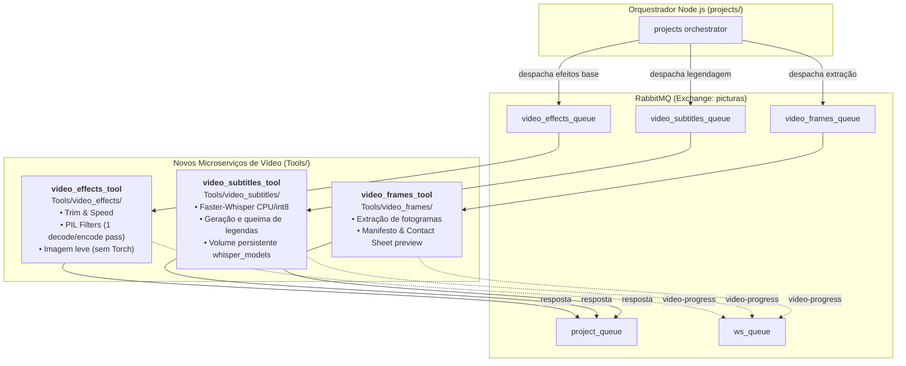

# Plano de Implementação — Membro A: Modularidade do Processamento de Vídeo

## 1. Identificação e Enquadramento

- **Requisito Não Funcional**: Manutenibilidade — Modularidade do processamento de vídeo.
- **Classificação ISO/IEC 25010:2011**: **Manutenibilidade** $\rightarrow$ **Modularidade** (*Modularity*) e **Reutilizabilidade** (*Reusability*).
- **Impactos Secundários Positivos**: **Eficiência de Desempenho** (*Comportamento Temporal / Utilização de Recursos*) e **Fiabilidade** (*Tolerância a Falhas / Isolamento de Falhas*).
- **Papel do Membro A**: Lead de Refactoring, Arquitetura de Software e Implementação Backend/Python.
- **Parceiro (Membro B)**: Lead de Métricas, Benchmarking, Medição de Baseline e Validação.

---

## 2. Diagnóstico Técnico da Solução de Base

Na solução de base (commit `0523102`), todo o suporte de vídeo está consolidado num único componente monolítico:
- Caminho: [`Tools/video/`](file:///home/simao/Desktop/uminho-mei/RAS/picturas-27/Tools/video/)
- Fila única: `video_queue` (exchange `picturas`)
- Serviço Compose: `video_tool`
- Dependências: [`Tools/video/requirements.txt`](file:///home/simao/Desktop/uminho-mei/RAS/picturas-27/Tools/video/requirements.txt) agrega simultaneamente manipulação leve com FFmpeg/Pillow e pacotes pesados de Inteligência Artificial (`faster-whisper`, `ctranslate2`, `torch`).

### Principais Fragilidades Identificadas:
1. **Baixa Coesão e Alto Acoplamento**: Tarefas de naturezas opostas (filtros rápidos de imagem/fotogramas vs. inferência pesada de rede neuronal para legendas em CPU) partilham o mesmo processo, o mesmo código base e o mesmo ciclo de vida de deployment.
2. **Pegada de Recursos e Tempo de Build Desproporcionais**: Para qualquer operação trivial (ex.: corte de 2 segundos com `trim` ou ajuste de `brightness`), o contentor Docker exige carregar dependências de IA (> 3.5 GB de imagem), tornando o build e deploy lentos e exigentes em disco e RAM.
3. **Ponto Único de Falha no Vídeo**: Se a transcrição com Whisper provocar um erro fatal de alocação de memória (Out-Of-Memory / SIGKILL) ou deadlock em CPU, o worker inteiro cai, interrompendo ou atrasando todas as restantes operações de vídeo pendentes na fila.

---

## 3. Arquitetura Alvo (Pós-Refactoring)

A solução consiste em decompor o monólito [`Tools/video/`](file:///home/simao/Desktop/uminho-mei/RAS/picturas-27/Tools/video/) em **3 microserviços autónomos**, cada um especializado num domínio funcional:



---

## 4. Roteiro Operacional de Implementação (Passo a Passo)

### Etapa 0: Criação da Branch e Trabalho em Paralelo (Sem Bloqueio)
> [!NOTE]
> Não é necessário esperar que o Membro B conclua a medição da baseline para começar a programar. Como o Git isola o trabalho por branches, o **Membro B retira as métricas da baseline diretamente a partir da branch `main` intacta** (commit `0523102`), enquanto o **Membro A desenvolve em paralelo na sua branch**.

- [ ] **Ação**: Criar e mudar imediatamente para a branch de trabalho dedicada:
  ```bash
  git checkout -b refactor/video-modularity
  ```
- [ ] **Alinhamento**: Confirmar com o Membro B que a branch `main` não deve receber commits até a baseline estar registada.

---

### Etapa 1: Criação dos 3 Microserviços em `Tools/`

#### 1.1 `Tools/video_effects/` (Efeitos Standard, Corte e Velocidade)
- [ ] Criar a diretoria [`Tools/video_effects/`](file:///home/simao/Desktop/uminho-mei/RAS/picturas-27/Tools/video_effects/) a partir de `Tools/video/`.
- [ ] **Ficheiros a manter/adaptar**:
  - `video.py`: configurar `VIDEO_QUEUE = "video_effects_queue"`, `MICROSERVICE = "picturas-video-effects-ms"`.
  - `video_processor.py`: remover referências e imports de `subtitles.py` e `frame_extraction.py`.
  - `effects.py`: manter a lógica PIL e FFmpeg de transformações de frame, `trim` e `speed`.
  - Manter a regra de eficiência documentada no [`AGENTS.md`](file:///home/simao/Desktop/uminho-mei/RAS/picturas-27/AGENTS.md): **descodificar uma vez, aplicar filtros nos frames e codificar uma só vez em MP4/H.264 + AAC**.
- [ ] **Limpar Dependências (`requirements.txt`)**:
  ```txt
  pika>=1.3.2
  pillow>=11.0.0
  pytz>=2024.1
  requests>=2.31.0
  ```
  *(Garantir a remoção total de `faster-whisper` e dependências PyTorch deste serviço).*

#### 1.2 `Tools/video_subtitles/` (Legendagem com IA)
- [ ] Criar a diretoria [`Tools/video_subtitles/`](file:///home/simao/Desktop/uminho-mei/RAS/picturas-27/Tools/video_subtitles/).
- [ ] **Ficheiros a manter/adaptar**:
  - `video.py`: configurar `VIDEO_QUEUE = "video_subtitles_queue"`, `MICROSERVICE = "picturas-video-subtitles-ms"`.
  - `subtitles.py`: lógica isolada do Faster-Whisper (deteção de idioma, transcrição CPU int8 e queima de legendas com FFmpeg).
  - `video_processor.py` (versão mínima): apenas orquestra a entrada do vídeo, chamada a `subtitles.py` e output final.
- [ ] **Dependências (`requirements.txt`)**:
  ```txt
  pika>=1.3.2
  faster-whisper>=1.0.0
  pytz>=2024.1
  requests>=2.31.0
  ```

#### 1.3 `Tools/video_frames/` (Extração de Fotogramas)
- [ ] Criar a diretoria [`Tools/video_frames/`](file:///home/simao/Desktop/uminho-mei/RAS/picturas-27/Tools/video_frames/).
- [ ] **Ficheiros a manter/adaptar**:
  - `video.py`: configurar `VIDEO_QUEUE = "video_frames_queue"`, `MICROSERVICE = "picturas-video-frames-ms"`.
  - `frame_extraction.py`: lógica de amostragem (por contagem 1–100 ou intervalo), geração de PNG/JPEG e montagem do contact sheet para preview.
- [ ] **Dependências (`requirements.txt`)**:
  ```txt
  pillow>=11.0.0
  pika>=1.3.2
  pytz>=2024.1
  requests>=2.31.0
  ```

---

### Etapa 2: Configuração de Mensageria (RabbitMQ)

Ficheiro a alterar: [`rabbitMQ/definitions.json`](file:///home/simao/Desktop/uminho-mei/RAS/picturas-27/rabbitMQ/definitions.json)

- [ ] Na secção `"queues"`, registar:
  ```json
  { "name": "video_effects_queue", "vhost": "/", "durable": true, "auto_delete": false, "arguments": {} },
  { "name": "video_subtitles_queue", "vhost": "/", "durable": true, "auto_delete": false, "arguments": {} },
  { "name": "video_frames_queue", "vhost": "/", "durable": true, "auto_delete": false, "arguments": {} }
  ```
- [ ] Na secção `"bindings"`, associar ao exchange `picturas`:
  ```json
  { "source": "picturas", "vhost": "/", "destination": "video_effects_queue", "destination_type": "queue", "routing_key": "video_effects_queue", "arguments": {} },
  { "source": "picturas", "vhost": "/", "destination": "video_subtitles_queue", "destination_type": "queue", "routing_key": "video_subtitles_queue", "arguments": {} },
  { "source": "picturas", "vhost": "/", "destination": "video_frames_queue", "destination_type": "queue", "routing_key": "video_frames_queue", "arguments": {} }
  ```

---

### Etapa 3: Orquestração de Contentores (Docker Compose)

Ficheiro a alterar: [`docker-compose.yaml`](file:///home/simao/Desktop/uminho-mei/RAS/picturas-27/docker-compose.yaml)

- [ ] Substituir o serviço monolítico `video_tool` por 3 serviços autónomos:
  1. `video_effects_tool`:
     - Build: `./Tools/video_effects`
     - Volumes: `image_data:/image_data`
     - Env: credenciais RabbitMQ, S3 e host.
  2. `video_subtitles_tool`:
     - Build: `./Tools/video_subtitles`
     - Volumes: `image_data:/image_data`, `whisper_models:/root/.cache/huggingface`
  3. `video_frames_tool`:
     - Build: `./Tools/video_frames`
     - Volumes: `image_data:/image_data`
- [ ] Assegurar que os 3 serviços incluem:
  ```yaml
  depends_on:
    rabbitmq:
      condition: service_healthy
  ```

---

### Etapa 4: Adaptação do Orquestrador (`projects/`)

#### 4.1 Mapeamento de Filas
Ficheiro: [`projects/utils/project_msg.js`](file:///home/simao/Desktop/uminho-mei/RAS/picturas-27/projects/utils/project_msg.js)
- [ ] Adicionar ao objeto `queues`:
  ```javascript
  'video_effects': 'video_effects_queue',
  'video_subtitles': 'video_subtitles_queue',
  'video_frames': 'video_frames_queue',
  ```

#### 4.2 Despacho do Pipeline de Vídeo
Ficheiros: [`projects/utils/video.js`](file:///home/simao/Desktop/uminho-mei/RAS/picturas-27/projects/utils/video.js) e [`projects/routes/projects.js`](file:///home/simao/Desktop/uminho-mei/RAS/picturas-27/projects/routes/projects.js)
- [ ] Analisar a lista de operações do pipeline para cada vídeo:
  - Se contiver apenas transformações standard (`brightness`, `cut`, `trim`, `speed`, etc.) $\rightarrow$ despachar para `video_effects`.
  - Se for `subtitles` $\rightarrow$ despachar para `video_subtitles`.
  - Se for `extract_frames` $\rightarrow$ despachar para `video_frames`.
  - **Pipelines Mistos**: Se um projeto tiver efeitos de vídeo seguidos de legendas, encadear o envio (o orquestrador recebe o resultado do primeiro na `project_queue` e avança para o microserviço seguinte, mantendo a regra de que o resultado intermediário é guardado no armazenamento S3).
- [ ] Garantir o registo prévio de todos os `Process` em lote antes do primeiro envio (regra explícita do [`AGENTS.md`](file:///home/simao/Desktop/uminho-mei/RAS/picturas-27/AGENTS.md)).

---

### Etapa 5: Validação de Convenções e Não-Regressão

- [ ] **Conformidade com o [`AGENTS.md`](file:///home/simao/Desktop/uminho-mei/RAS/picturas-27/AGENTS.md)**:
  - Código, nomes de variáveis, comentários e docstrings estritamente em **Inglês**.
  - Confirmação explícita de mensagens: cada worker faz `basic_ack` apenas no final do job.
  - Eventos de progresso enviados para a fila `ws_queue` como `video-progress`.
  - Preservação de line endings (CRLF vs LF) sem reformatar ficheiros alheios.
  - Mensagens de commit descritivas (< 72 caracteres, ex.: `refactor(video): extract subtitles into standalone microservice`).
- [ ] **Execução de Testes Unitários de Vídeo**:
  ```bash
  cd Tools/video_effects && pytest -v tests
  ```
- [ ] **Execução de Testes do Orquestrador**:
  ```bash
  cd projects && node --test tests/*.test.js
  ```

---

### Etapa 6: Passagem de Testemunho ao Membro B
- [ ] Disponibilizar o ambiente estabilizado na branch para o **Membro B**:
  1. Executar a **Medição Final** (`radon mi` nos novos módulos, medição dos novos tamanhos de imagem Docker e tempo de build limpo).
  2. Executar os testes de **Isolamento de Falhas** (validar que desligar o `video_subtitles` não bloqueia o `video_effects`).
  3. Gerar os gráficos comparativos da melhoria para o relatório da Fase 2.
